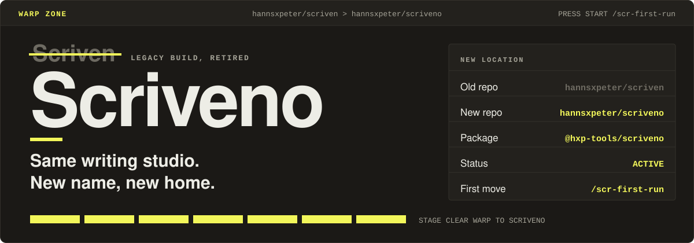

<p align="center">
  <a href="https://github.com/hannsxpeter/scriveno"></a>
</p>

<p align="center">
  <a href="https://github.com/hannsxpeter/scriveno"></a>
  <a href="https://www.npmjs.com/package/@hxp-tools/scriveno"></a>
</p>

<h3 align="center">Scriven has become Scriveno. This repository is retired.</h3>

<p align="center"><em>Stage clear. The game continues at <a href="https://github.com/hannsxpeter/scriveno">github.com/hannsxpeter/scriveno</a>.</em></p>

---

## Warp zone

Nothing new ships here. Code, documentation, issues, and releases all live in the Scriveno repository:

| Looking for | Go to |
|---|---|
| Code and README | [hannsxpeter/scriveno](https://github.com/hannsxpeter/scriveno) |
| Documentation | [scriveno/docs](https://github.com/hannsxpeter/scriveno/tree/main/docs) |
| Issues | [scriveno/issues](https://github.com/hannsxpeter/scriveno/issues) |
| Releases | [scriveno/releases](https://github.com/hannsxpeter/scriveno/releases) |
| npm package | [@hxp-tools/scriveno](https://www.npmjs.com/package/@hxp-tools/scriveno) |

## Press start

```bash
npx @hxp-tools/scriveno@latest
```

That installs Scriveno into your AI coding agent. Then run `/scr-first-run` in Claude Code, `$scr-first-run` in Codex, or `/scr:first-run` in other slash-command hosts.

The older `scriven-cli` and `scriveno-cli` npm packages are retired. Use `@hxp-tools/scriveno` for every new install.
